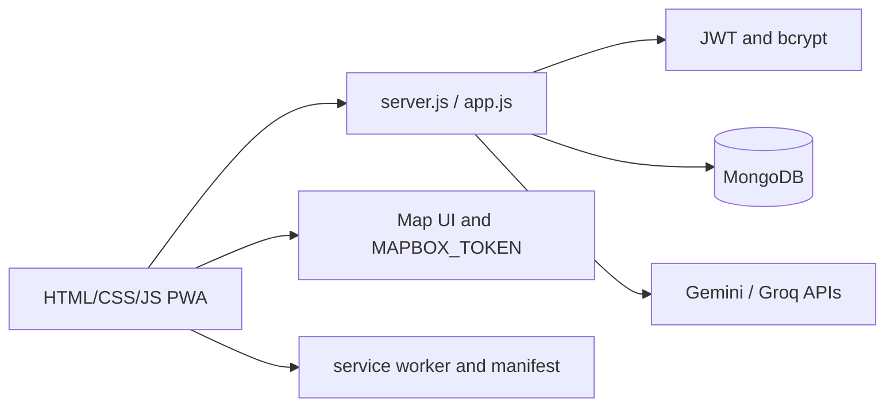

# EcoRoute (Infothon 2.0)

A Node.js/Express progressive web application for smart, real-time waste collection. It combines map views, driver/collection-point workflows, authentication, localization, Firebase helpers, MongoDB persistence, and optional Gemini/Groq assistance.

## Architecture



`server.js` exposes the backend; browser modules such as `map.js`, `driver.js`, `point.js`, `login.js`, and `i18n.js` implement user workflows. `data.js`, `firebase.js`, and maintenance scripts support data operations.

## Setup

```bash
npm ci
cp .env.example .env
npm start
# development
npm run dev
```

Required deployment variables are documented by `render.yaml`: `MONGO_URI`, `JWT_SECRET`, `MAPBOX_TOKEN`, `GOOGLE_API_KEY`, and `GROQ_API_KEY`.

## Core workflow and API

Users authenticate, view collection points on a map, and submit/track pickup or driver updates. The Express API validates requests, persists domain records in MongoDB, and serves the static PWA. Exact endpoint behavior is defined in `api.js` and `server.js`; keep browser and server changes synchronized.

## Deployment

Render runs `npm install` and `npm start` with Node.js 18+. Use HTTPS, a persistent database, a restrictive CORS policy, and production service-worker cache/versioning.

## Testing and limitations

`test_db.js` is the available database probe; no full automated suite is configured. Test offline/PWA behavior, map-token failures, role authorization, duplicate submissions, and AI/API outages before launch.

## Security and operations

- Keep credentials, database URLs, OAuth tokens, API keys, and signing secrets in environment variables; never commit them.
- Validate and constrain uploaded files and user input at the server boundary, and enable HTTPS in production.
- Review dependency updates and rotate any credential that has appeared in repository history.

## Testing

The repository currently has no comprehensive automated test suite unless noted above. Before production changes, add tests for authentication/authorization, validation failures, persistence errors, and the primary user workflow.

## Limitations and roadmap

This is an actively evolving project. Production hardening, observability, rate limiting, backup/retention policy, and accessibility/performance validation should be completed before handling sensitive or high-volume workloads.

## License

See the repository license file and package metadata for the authoritative terms.
